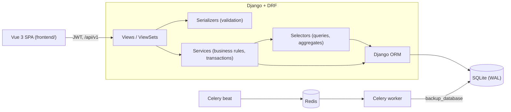

# Architecture

## Backend layout

| Path | Contents |
|---|---|
| `config/` | Settings (`base`, `development`, `production`, `test`), URLs, Celery app |
| `apps/common/` | `BaseModel` (audit fields), soft delete, role permissions, error handler, backups |
| `apps/users/` | Custom user (`user_name` login), auth endpoints, user management |
| `apps/products/` | Products, code generation, `StockService`, Excel/PDF exports |
| `apps/sales/` | Bills and orders, `BillService`, `OrderService` |
| `apps/notes/` | Notes |
| `apps/dashboard/` | Shop configuration and statistics |
| `apps/legacy_import/` | One-time Laravel MySQL import |
| `utils/` | Shared enums, constants, serializer base class |
| `legacy_laravel/` | The previous Laravel app, kept for reference only |

Each app follows: `models.py`, `serializers.py` (validate and shape data), `services.py`
(business operations), `selectors.py` (read queries), `views.py` (thin HTTP layer),
`filters.py`, `urls.py`, `tests/`.

## Conventions

- Every model inherits `BaseModel` (`created_at`, `updated_at`, `created_by`, `updated_by`).
- Products, bills, orders and users are soft-deleted (`SoftDeleteModel`). `objects` hides
  deleted rows; `all_objects` includes them. Foreign keys still resolve to deleted rows.
- Errors always look like `{"detail": "...", "errors": {...} | null}`. User-facing messages are Arabic.
- Money is `Decimal` in the database and serialized as JSON numbers.
- Lists use limit/offset pagination (`limit` default 50, max 1000).

## Frontend layout

| Path | Contents |
|---|---|
| `src/api/` | Axios client (token refresh), typed endpoint functions |
| `src/stores/` | Pinia: `auth` (user, role checks), `shop` (configuration) |
| `src/router/` | Routes with `roles` / `public` / `blank` meta and the auth guard |
| `src/views/` | One view per screen |
| `src/components/` | Layout, receipt, pagination, form helpers |
| `src/composables/usePaginatedList.ts` | Filters + pagination + loading state for list pages |
| `src/utils/` | Formatting, error messages, bill totals, downloads |
