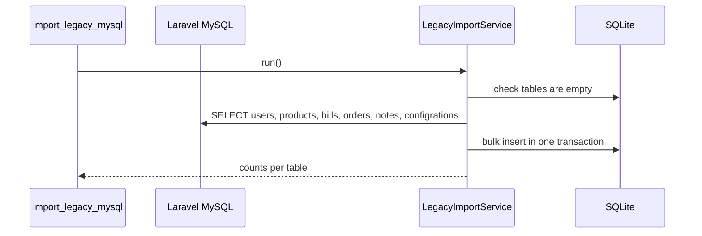

# Notes, backups and the legacy data import

## Notes

**Purpose:** a shared notice board for the shop staff.

**Actors:** every role reads and adds notes; only a master edits or deletes them.

**APIs:** `GET/POST /api/v1/notes/`, `GET/PATCH/PUT/DELETE /api/v1/notes/{id}/`
(`ReadOrCreateOrIsMaster`).

## Database backups

**Purpose:** keep copies of the SQLite database.

**Workflow:** Celery beat runs `apps.common.tasks.backup_database` at 00:00 and 12:00
(`CELERY_BEAT_SCHEDULE`). It uses SQLite's online backup API, which is safe while the app
writes, and saves `BACKUP_DIR/YYYY-MM-DD-HHMM.sqlite3`. Run it by hand with
`python manage.py backup_database` (or `make backup`), or from cron if you do not run Celery.

**Rules:** backups are not pruned automatically. Copy them off the server too.

## One-time import from the Laravel MySQL database

**Purpose:** move the existing shop data into the new SQLite database.

**Actors:** whoever deploys the new system, once.

**Workflow:**

1. Create and migrate an empty database: `python manage.py migrate`.
2. Set `LEGACY_DB_HOST`, `LEGACY_DB_PORT`, `LEGACY_DB_USER`, `LEGACY_DB_PASSWORD`,
   `LEGACY_DB_NAME` (or pass `--host/--port/--user/--database`; the password is read only
   from the environment so it stays out of shell history).
3. Run `python manage.py import_legacy_mysql`.

**Rules (see `apps/legacy_import/services.py`):**

- Runs in one transaction and refuses to run if users, products, bills, orders or notes exist.
- Keeps ids, `created_at`, `updated_at` and `deleted_at` (Laravel stored UTC).
- `user_id` becomes `created_by` and `updated_by`. Links to missing users, products or bills
  become empty instead of failing.
- Laravel bcrypt passwords keep working. Role 1 users become Django superusers.
- Duplicate `user_name`s get an `_<id>` suffix. Missing or duplicate product codes among alive
  products get a new code. Each change is logged.
- Configuration row 1: `title`, `phone`, `address`, `email` are copied.
- Not imported: `categories`, `governorates`, `cities`, `bills_products`, `order_products`,
  `password_resets` (unused by the old app), and the product `total_price` / `discount`
  columns (now computed / unused).

