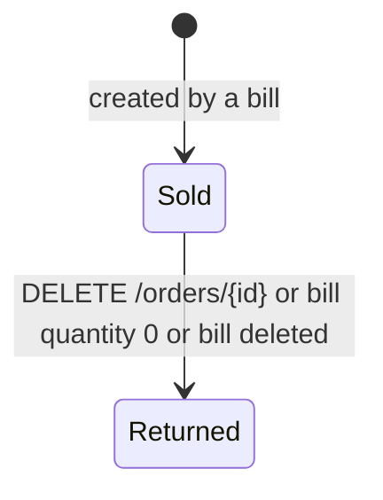
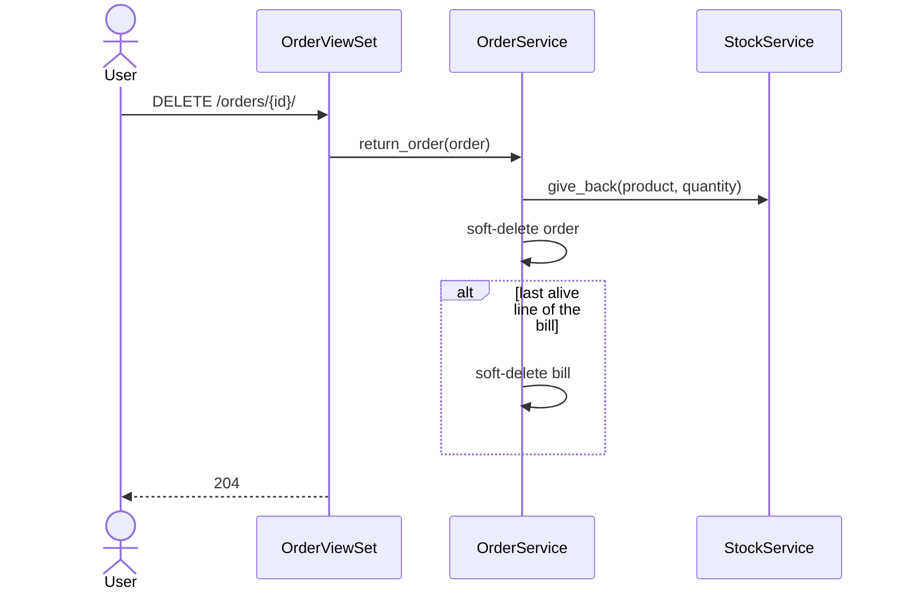

# Orders and returns

## Purpose

Browse sold lines and returned lines by period, see totals, and return a single line.

## Actors

Every signed-in role.

## Workflow

1. **الطلبات** lists sold lines (`GET /api/v1/orders/`). Quick filters: today, this month,
   this year, and the same three for returns (`returned=true`). A "from date" filter and a
   search (product name, product code, customer name) are also available.
2. `GET /api/v1/orders/summary/` returns count, quantity and money for the same filters.
3. The return button calls `DELETE /api/v1/orders/{id}/`.

## Business rules

- Sold lines are orders with `deleted_at IS NULL`; returned lines have `deleted_at` set.
- Period filters use the order's sale `date`, not the return date. A return list shows both.
- Returning a line gives its quantity back to stock with the rules in
  [sales-bills.md](sales-bills.md). If it was the bill's last alive line, the bill is
  returned too.
- An already returned line cannot be returned again (404).
- Orders cannot be created directly; they are created only through bills.

## State machine

## Related models

`Order`, `Bill`, `Product`.

## Related APIs

| Method | Path | Query parameters |
|---|---|---|
| GET | `/api/v1/orders/` | `returned`, `date`, `date_from`, `date_to`, `year`, `month`, `bill`, `search`, `ordering`, `limit`, `offset` |
| GET | `/api/v1/orders/summary/` | same filters |
| DELETE | `/api/v1/orders/{id}/` | |

## Sequence diagram

