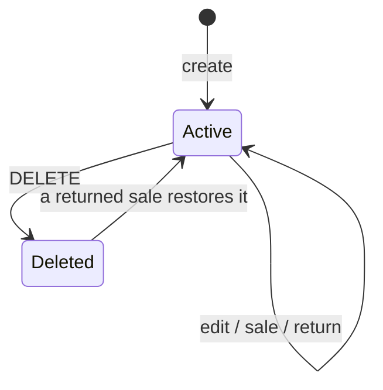
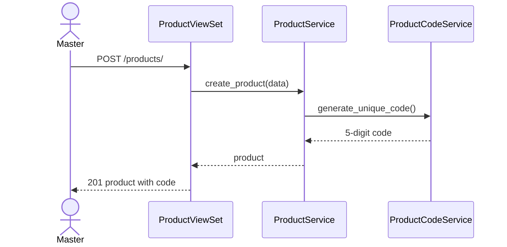

# Products and stock

## Purpose

Keep the product catalogue and stock levels, print barcode labels, and export the list.

## Actors

Master (role 1) manages products. Every role can look a product up by code while selling.

## Workflow

1. **المنتجات** lists products with totals (`GET /api/v1/products/` and `/summary/`).
   "Running out" shows products with `quantity < 5`; rows under 3 are highlighted.
2. Create or edit name, purchasing price, selling price and quantity. The server generates
   the barcode `code` on create.
3. The barcode page renders a CODE39 label (JsBarcode) with name, code and price, and prints it.
4. Excel and PDF exports download the products created in the current year (`?year=` overrides).

## Business rules

- `code` is a random 5-digit number that no product, deleted ones included, has used.
  It is unique among alive products (partial unique index).
- Totals (`total_purchasing_price`, `total_selling_price`) are computed from price and
  quantity at read time; they are not stored.
- Deleting a product is a soft delete. Old orders keep pointing at it, and a return can
  restore it.
- Stock only changes through `StockService` (sales, returns) or a master's manual edit.

## State machine

## Related models

`apps.products.models.Product`.

## Related APIs

| Method | Path | Role |
|---|---|---|
| GET/POST | `/api/v1/products/` | master |
| GET/PATCH/PUT/DELETE | `/api/v1/products/{id}/` | master |
| GET | `/api/v1/products/summary/` | master |
| GET | `/api/v1/products/export/excel/`, `/export/pdf/` | master |
| GET | `/api/v1/products/by-code/{code}/` | any signed-in user |

## Sequence diagram

