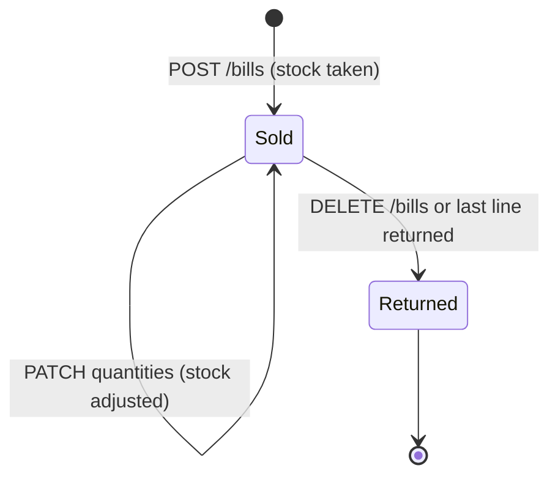
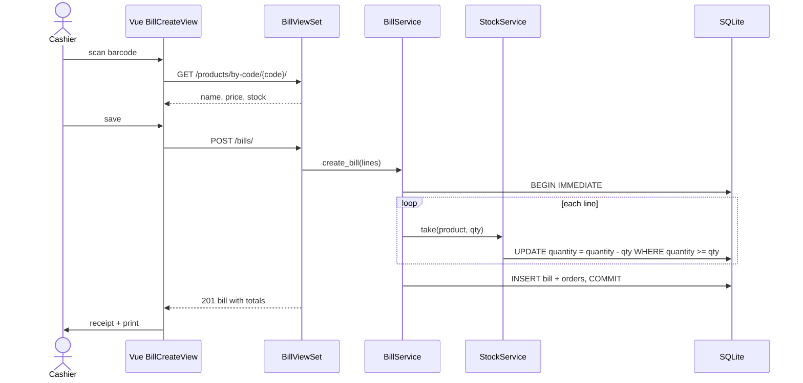

# Sales: bills and stock

## Purpose

Sell products at the counter. A bill (invoice) holds one order line per product. Stock is
taken when the bill is saved and given back when a line or bill is returned.

## Actors

Every signed-in role (master, admin, employee).

## Workflow

1. The cashier opens **فاتورة جديدة** and scans barcodes (or types codes). Each scan calls
   `GET /api/v1/products/by-code/{code}/`. A repeated code raises that line's quantity.
2. The cashier sets optional customer name, phone, per-line discount and bill discount.
3. `POST /api/v1/bills/` sends `{name, phone, discount, items: [{code, quantity, discount, price?}]}`.
4. The server, in one transaction, checks every code and takes stock line by line. If a code
   is unknown or stock is short, it returns 400 with an Arabic `detail`, and nothing is saved.
5. On success the response is the full bill with totals. The frontend shows the receipt and
   can open `/bills/{id}/receipt?print=1` in a print window.

Editing (`PATCH /api/v1/bills/{id}/`) changes customer data, the bill discount, and line
quantities through `orders: [{id, quantity}]`.

Deleting (`DELETE /api/v1/bills/{id}/`) returns the whole bill.

## Business rules

- Line total = `price * quantity - line discount` (the discount is per line, not per unit).
- Bill net = sum of line totals - bill discount.
- A line discount cannot exceed its line total; a bill discount cannot exceed the lines total.
- `price` defaults to the product's selling price. `product_name` and `product_price` are
  copied at sale time, so later product edits do not change old bills.
- Stock changes are conditional `UPDATE ... WHERE quantity >= n` statements, so concurrent
  sales cannot push stock below zero.
- Raising a line quantity takes the difference from stock; lowering it gives it back.
  Quantity `0` returns the line. A bill left without lines is returned too.
- Giving stock back (see `StockService.give_back`):
  - product exists: add the units;
  - product is soft-deleted: restore it holding only the returned units;
  - product row no longer exists: re-create it with a new code.
- A soft-deleted order or bill **is** a return. Statistics and the orders `returned` filter
  depend on this.

## State machine

## Related models

`apps.sales.models.Bill`, `apps.sales.models.Order`, `apps.products.models.Product`.

## Related APIs

| Method | Path | Notes |
|---|---|---|
| GET | `/api/v1/bills/?year=&search=` | Alive bills with alive lines and totals |
| POST | `/api/v1/bills/` | Create and take stock |
| GET | `/api/v1/bills/{id}/` | One bill (also returned bills) |
| PATCH | `/api/v1/bills/{id}/` | Customer data, discount, line quantities |
| DELETE | `/api/v1/bills/{id}/` | Return the whole bill |
| GET | `/api/v1/products/by-code/{code}/` | Barcode lookup |

## Sequence diagram

