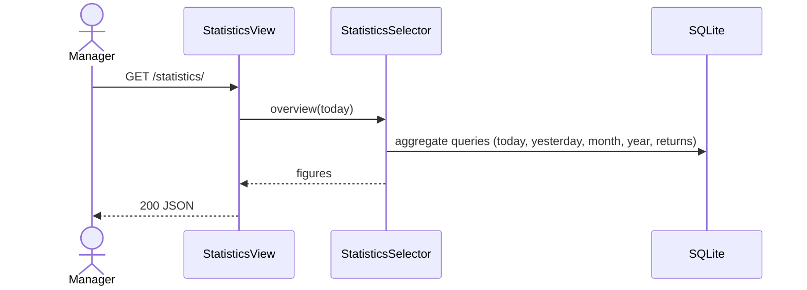

# Statistics and shop configuration

## Purpose

Show daily, monthly and yearly sales figures, and edit the shop details printed on receipts.

## Actors

Master and admin (roles 1 and 2). Every role can read the configuration (receipts need it).

## Workflow

1. **احصائيات السستم** loads `GET /api/v1/statistics/` and `GET /api/v1/configuration/`.
2. Saving the form sends `PATCH /api/v1/configuration/`.

## Business rules

All money figures use sold (not returned) lines with `status = sold-out`.

| Figure | Definition |
|---|---|
| `orders_count` | Sold lines with sale `date` in the period |
| `orders_money` | Sum of `quantity * price - discount` |
| `orders_discount` | Sum of line discounts |
| `bills_discount` | Sum of bill discounts for alive bills created that day |
| `total_discount` | `orders_discount + bills_discount` |
| `goods_cost` | Sum of `quantity * product.purchasing_price` (current price, deleted products included) |
| `net_profit` | `orders_money - goods_cost - bills_discount` (today and yesterday) |
| `returned_count` / `returned_money` | Returned lines dated today; money minus discounts of returned bills created today |
| `out_of_stock_products` | Alive products with `quantity <= 0` |

"Today" is the server's local date (`TIME_ZONE`, default `Africa/Cairo`).

The configuration is a single row (`pk = 1`) created by a data migration: shop name, phone,
address, email, receipt header (commercial register and tax numbers), and receipt footer
(return policy).

## State machine

Not applicable (read-only figures and a single settings row).

## Related models

`ShopConfiguration`, `Order`, `Bill`, `Product`.

## Related APIs

| Method | Path | Role |
|---|---|---|
| GET | `/api/v1/statistics/` | master, admin |
| GET | `/api/v1/configuration/` | any signed-in user |
| PATCH/PUT | `/api/v1/configuration/` | master, admin |

## Sequence diagram

