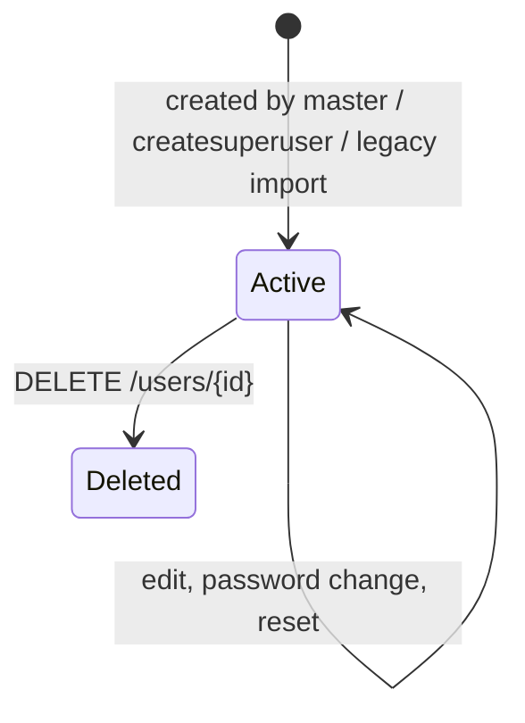
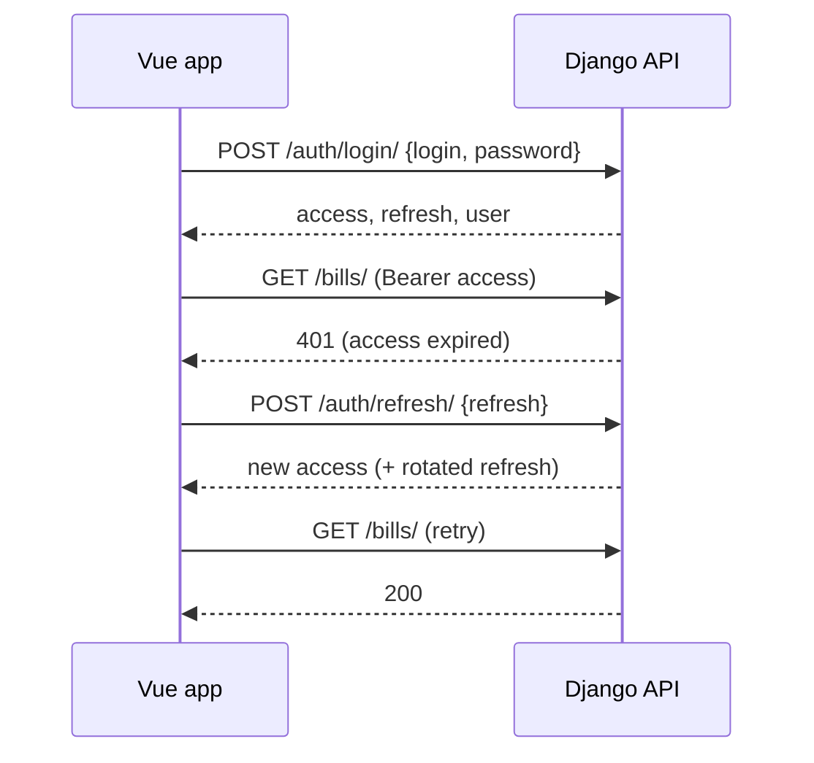

# Users, roles and authentication

## Purpose

Sign staff in, keep sessions, manage staff accounts, and reset forgotten passwords.

## Actors

| Role | Value | Can use |
|---|---|---|
| Master (مدير عام) | 1 | Everything, including users and products |
| Admin (مسؤول) | 2 | Statistics and configuration, bills, orders, notes |
| Employee (موظف) | 3 | Bills, orders, notes, own account |

Roles are enforced by DRF permission classes in `apps/common/permissions.py`. The Vue router
and sidebar hide what a role cannot use, but the API is the real check.

## Workflow

1. `POST /api/v1/auth/login/` with `login` (user name **or** email) and `password` returns
   `access` and `refresh` JWTs and the user.
2. The frontend sends `Authorization: Bearer <access>`. On a 401 it calls
   `/auth/refresh/` once, retries, and sends the user to the login page if refresh fails.
3. `POST /api/v1/auth/logout/` blacklists the refresh token.
4. `GET/PATCH /api/v1/auth/me/` shows and edits the signed-in user's own account.
5. Forgotten password: `POST /auth/password-reset/` emails a link to
   `{FRONTEND_URL}/reset-password/{uid}/{token}`; the page posts to
   `/auth/password-reset/confirm/`.

## Business rules

- `user_name` is unique, deleted users included. Email must be unique among active users.
- Passwords pass Django's validators (minimum 6 characters, not common, not only digits).
- A master creates users with role admin or employee only; nobody can create another master
  through the API (use `createsuperuser`).
- Nobody can change their own role, the role of a master, or delete their own account.
- Deleting a user is a soft delete; the user can no longer sign in and their tokens stop working.
- The password reset endpoint answers the same way whether or not the email exists.
- Login is throttled (10/minute per client); password reset is limited to 5/hour.
- Passwords imported from Laravel are bcrypt hashes; Django re-hashes them on the next login.

## State machine

## Related models

`apps.users.models.User`, simplejwt `OutstandingToken` / `BlacklistedToken`.

## Related APIs

| Method | Path | Role |
|---|---|---|
| POST | `/api/v1/auth/login/`, `/auth/refresh/` | public |
| POST | `/api/v1/auth/logout/` | signed in |
| GET/PATCH | `/api/v1/auth/me/` | signed in |
| POST | `/api/v1/auth/password-reset/`, `/confirm/` | public |
| GET/POST | `/api/v1/users/` | master |
| GET/PATCH/PUT/DELETE | `/api/v1/users/{id}/` | master |

## Sequence diagram

